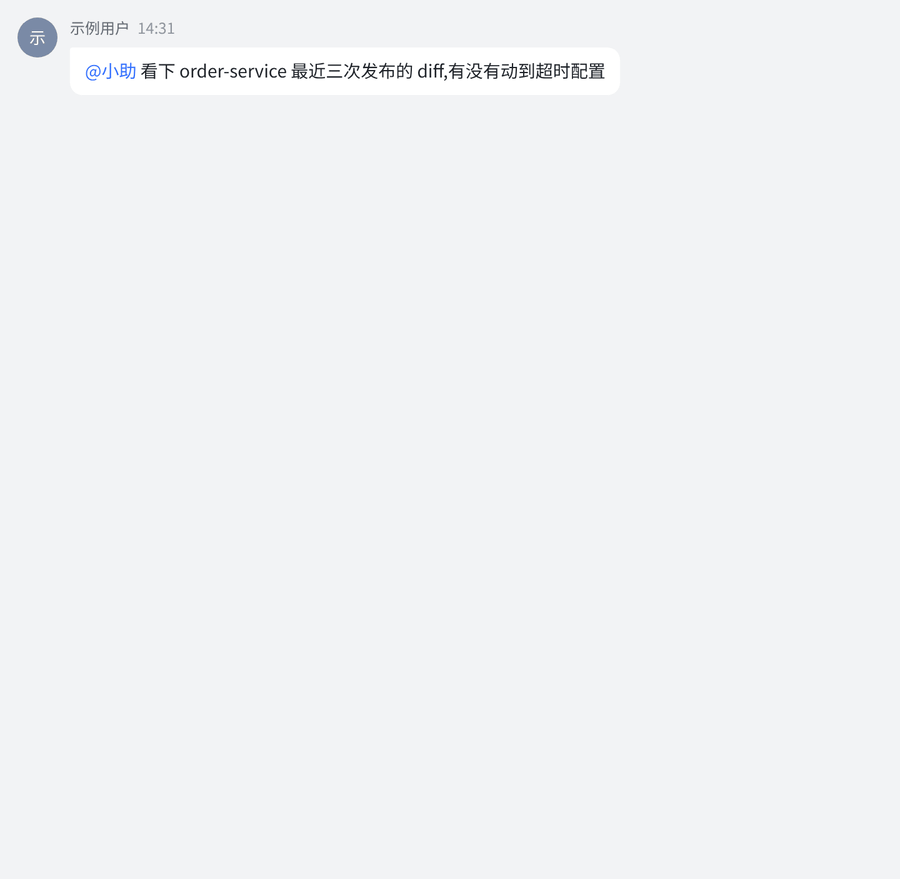

# summon

[简体中文](README.md) | English

[](https://github.com/baozzz1/summon/actions/workflows/checks.yml)
[](https://github.com/baozzz1/summon/actions/workflows/release.yml)
[](https://github.com/baozzz1/summon/releases/latest)
[](LICENSE)

**Bring your coding agent into Feishu (Lark).** @ a bot in a group chat and it runs
Claude Code, Codex, Cursor or Trae on your own machine, then posts the result back to the chat.



> You (in a Feishu group): `@Helper look at the diffs of the last three order-service releases — did any of them touch the timeout config?`
>
> Helper: (the card streams which files it reads and which commands it runs) …only the 8-18 release did:
> `client_timeout` went from 3s to 800ms. Here is the PR.

Behind the bot is **a CLI session on your own machine**: your own model subscription, your own
repositories, your own development environment. summon brings messages in, sends replies back and
manages the session lifecycle. It supports session resume, streaming replies, scheduled tasks and
multiple agents. The CLI, daemon and Go sidecar run on macOS and Linux; the Menu Bar app runs on macOS.

New features, improvements and fixes for each version are listed in the [Release Notes](RELEASE_NOTES.md)
(in Chinese), recorded from 0.6.20 on.

## Five-minute start

```sh
curl -fsSL https://raw.githubusercontent.com/baozzz1/summon/main/scripts/install.sh | sh
summon onboard
```

The first command installs the prebuilt package (platforms and checks are described under
"Install and upgrade"). `onboard` is an interactive wizard: it picks a CLI and checks its dependencies,
creates or binds a Feishu app, verifies the credentials, walks you page by page through permissions and
event subscriptions, tests the setup with a real message, and starts the daemon. At the end it prints a
"handoff block"; send it to your agent and it will know how summon is configured. After that, message the
bot in Feishu: send directly in a private chat, or @ it in a group. If nothing happens, run `summon doctor`
first.

Before you start:

- At least one AI CLI that is logged in and on your PATH: Claude Code, Codex, Cursor or Trae.
- Interactive Claude Code sessions need tmux 3.6 or newer.
- A Feishu account that can create custom enterprise apps. The app needs the bot capability and
  long-connection event subscription. The open platform has no API for creating apps, so this step is
  done by hand in the browser, with direct links and a checklist from the wizard.
- Node.js: the wizard installs `lark-cli` with `npx @larksuite/cli@latest install`; features that use
  Feishu tools depend on it. An existing installation is reused.

## What it is good for

- **Hand off work when you are away from your computer.** Send one message from your phone; the result
  is in the chat when you are back.
- **No babysitting long tasks.** Let it run an evaluation or a build and report back when it is done, or
  run periodic checks and push only the conclusions.
- **Several agents, each with its own identity.** Every bot is a separate Feishu app with its own name,
  avatar, persona (`SOUL.md`), working directory and memory, so the one writing code and the one
  reviewing it can be different agents.
- **The process is visible to everyone in the chat.** What it read, what it ran and what it concluded
  are all in the card; no screenshots needed.
- **Context is not lost.** Sessions survive daemon restarts; after an idle exit, the next message
  resumes the session through the CLI's native resume; after an archive, the next message starts a new
  session, and `/resume` brings the old one back.

## Who should use it / who should not

**Good fit**: your team uses Feishu; you already use Claude Code, Codex, Cursor or Trae; you want the
agent's work to be visible in the chat.

**Not a fit**: you do not use Feishu (summon is tightly coupled to Feishu's long connection and cards;
switching to another IM is not a configuration change); you want a hosted service (summon runs entirely
on your own machine and has no server side).

## Install and upgrade

Prebuilt packages for Linux (x86_64 and arm64; Ubuntu 22.04 / Debian 12 or newer) and Apple Silicon
macOS are published on GitHub Releases. Other platforms build from source.

The install script downloads the package for your platform, checks its size, SHA-256 and contents (on
macOS it checks the code signature first), then runs the extracted program to check its build stamp,
installs `summon` and `summon-sidecar` (plus `summon-menubar` on macOS) into `~/.summon/bin/`, and
reminds you to add that directory to your PATH. `SUMMON_INSTALL_VERSION=x.y.z` installs a specific
version. An existing installation is not overwritten.

Upgrade to the latest version and restart the daemon with it:

```sh
summon upgrade
summon upgrade --check   # only check whether a new version exists
```

`summon upgrade` never downgrades; when the daemon is not running it only replaces the files and does not
start it.

Automatic upgrade is off by default. With `auto: true` under `upgrade:` in `~/.summon/config.yaml`, the
daemon checks Releases periodically and switches to a new version only after it has been published for
two hours and the whole machine has been idle for ten minutes, so running conversations are not
interrupted. If the new version fails to start, the previous program is restored and that version is not
adopted automatically again. See `summon guide config` for the fields and `summon doctor` for the status.

## Build from source

You need stable Rust and Go (see `sidecar/feishu-connector/go.mod` for the version). Building the
Menu Bar app on macOS also needs a Swift 6 toolchain.

```sh
cargo build --release --locked
(cd sidecar/feishu-connector && go build -trimpath -o ../../target/release/summon-sidecar .)
# macOS, optional
swift build --package-path menubar -c release
```

To install on this machine and start the service, run the deploy script. It updates `~/.summon/bin/` and
restarts the daemon; run the same command again to upgrade.

```sh
sh scripts/deploy.sh --install
# macOS, optional: install the Menu Bar app as well
sh scripts/deploy.sh --install --menubar
```

## Configuration and usage

```sh
summon onboard
summon doctor
summon guide
```

`onboard` guides you through creating the bot configuration and connecting your local CLI. Message the
bot directly in a private chat; mention it in a group. Commands, configuration and troubleshooting are
covered by the manual shipped with the binary:

```sh
summon guide commands
summon guide config
summon guide troubleshooting
```

Runtime data lives in `~/.summon/`, including bot credentials, identity files, session records and
scheduled tasks. These files are managed locally by you. Keep the source checkout and the runtime data
directory separate.

## Development and verification

Module boundaries are described in the [architecture notes](docs/architecture.md) (in Chinese); the
development rules are in [CLAUDE.md](CLAUDE.md) (in Chinese).

```sh
bash scripts/verify.sh
python3 scripts/check-public-content.py
```

`verify.sh` runs the local machine checks. Tests that need a logged-in real service are run separately by
developers in a test environment of their choice. Committed content uses synthetic data; credentials are
injected through local configuration. `check-public-content.py` checks for things that should not appear
in the source: credentials, values that look like real platform identifiers, local paths, email addresses
and the like.

## Related projects

- [larksuite/cli](https://github.com/larksuite/cli) (`lark-cli`): the official Feishu / Lark CLI.
  `summon onboard` installs it, and features that use Feishu tools depend on it; agents can also use it
  directly in a session to read and write Feishu messages, docs, sheets and calendars.

## License

MIT, see [LICENSE](LICENSE). Licenses of third-party assets are kept in the corresponding asset
directories.
