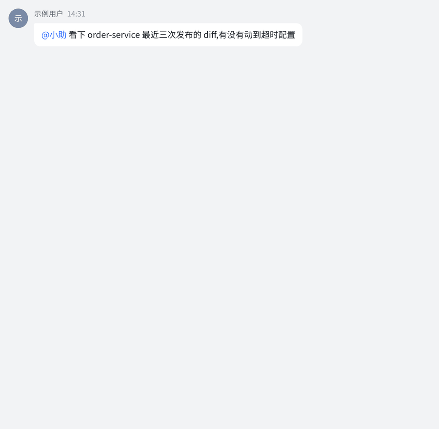

# summon

**让你的 coding agent 住进飞书。** 在群里 @ 一个机器人，它在你自己的机器上运行
Claude Code、Codex、Cursor 或 Trae，完成后把结果发回群里。



> 你（飞书群里）：`@小助 看下 order-service 最近三次发布的 diff，有没有动到超时配置`
>
> 小助：（卡片里流式显示它在读哪些文件、执行了什么命令）……三次里只有 8-18 那次动了，
> `client_timeout` 从 3s 改成 800ms，PR 在这里。

机器人背后是**你本机的 CLI 会话**：你自己的模型订阅、你自己的代码仓、你自己的开发环境。
summon 负责把消息接进来、把回复发回去，并管理会话的生命周期。它支持会话续接、流式回复、
定时任务和多 agent 管理。CLI、daemon 和 Go sidecar 支持 macOS、Linux；Menu Bar 应用支持 macOS。

各版本的新增功能、改进与修复见 [Release Notes](RELEASE_NOTES.md)，从 0.6.20 起记录。

## 五分钟上手

```sh
curl -fsSL https://raw.githubusercontent.com/baozzz1/summon/main/scripts/install.sh | sh
summon onboard
```

第一条命令安装预编译包（平台与校验见「安装与升级」）。`onboard` 是交互向导：选 CLI 并检查依赖、
创建或绑定飞书应用、验证凭据、逐页引导配置权限与事件订阅、用一条真实消息联调、启动 daemon。
向导最后打印一段「交接块」，把它发给你的 agent，它就知道 summon 怎么配置。之后在飞书里给机器人
发消息：私聊直接发，群里 @ 它。没有反应先执行 `summon doctor`。

开始前准备：

- 至少一个已登录、在 PATH 上的 AI CLI：Claude Code、Codex、Cursor 或 Trae。
- 使用 Claude Code 的交互会话时需要 tmux 3.6 或更新版本。
- 一个能创建企业自建应用的飞书账号。应用要开启机器人能力和长连接事件订阅；开放平台没有
  创建应用的 API，这一步由向导给出直达链接和清单，在浏览器里手工完成。
- Node.js：向导用 `npx @larksuite/cli@latest install` 安装 `lark-cli`，需要飞书工具的功能依赖它。
  已经装好的会直接沿用。

## 它适合做什么

- **不在电脑前也能派活。** 手机上发一句，回来时结果已经在群里。
- **长任务不用盯。** 让它跑评测或构建，跑完自己回来汇报；也可以定时巡检，只推送结论。
- **多个 agent 各有身份。** 每个机器人是独立的飞书应用，有自己的名字、头像、人格（`SOUL.md`）、
  工作目录和记忆，写代码的和做评审的可以分开。
- **过程对群里的人可见。** 它读了什么、执行了什么、结论是什么，都在卡片里，不用截图转述。
- **上下文不丢。** 会话跨 daemon 重启存活；空闲退出后，下次说话按 CLI 原生 resume 接回来；
  归档后下次新建，`/resume` 可恢复。

## 谁该用 / 谁不该用

**适合**：团队用飞书；你已经在用 Claude Code、Codex、Cursor 或 Trae；想让 agent 的工作在群里可见。

**不适合**：不用飞书（summon 与飞书长连接、卡片深度耦合，换 IM 不是改配置的事）；
想要托管服务（summon 全部运行在你自己的机器上，没有服务端）。

## 安装与升级

Linux（x86_64、arm64，Ubuntu 22.04 / Debian 12 及更新的发行版）与 Apple Silicon 的 macOS
有预编译包，发布在 GitHub Releases。其他平台从源码构建。

安装脚本下载本平台的包，核对字节数、SHA-256 与包内文件（macOS 上先核代码签名），再运行解出的程序
核对构建戳，把 `summon`、
`summon-sidecar`（macOS 另有 `summon-menubar`）装进 `~/.summon/bin/`，并提示把这个目录加进 PATH。
`SUMMON_INSTALL_VERSION=x.y.z` 安装指定版本。已安装过的不覆盖。

升级到新版并用它重启 daemon：

```sh
summon upgrade
summon upgrade --check   # 只看有没有新版
```

`summon upgrade` 不降级；daemon 没在运行时只替换文件、不启动它。

自动升级默认关。在 `~/.summon/config.yaml` 里写 `upgrade:` 下的 `auto: true` 后，daemon 定期查 Release，新版发布满两小时、整机空闲十分钟才换代，不打断在跑的对话；新版起不来就放回换代前的程序，不再自动采用这一版。字段见 `summon guide config`，状态看 `summon doctor`。

## 从源码构建

准备 Rust stable、Go（版本要求见 `sidecar/feishu-connector/go.mod`）。
macOS 上构建 Menu Bar 还需要 Swift 6 工具链。

```sh
cargo build --release --locked
(cd sidecar/feishu-connector && go build -trimpath -o ../../target/release/summon-sidecar .)
# macOS 可选
swift build --package-path menubar -c release
```

需要安装到本机并启动服务时，运行安装脚本。它会更新 `~/.summon/bin/` 并重启 daemon；
升级时重新运行同一条命令。

```sh
sh scripts/deploy.sh --install
# macOS 可选：同时安装 Menu Bar
sh scripts/deploy.sh --install --menubar
```

## 配置与使用

```sh
summon onboard
summon doctor
summon guide
```

`onboard` 引导创建机器人配置并连接本地 CLI。在飞书私聊中直接发消息，在群聊中提及机器人。
具体命令、配置项和故障排查使用随二进制分发的手册：

```sh
summon guide commands
summon guide config
summon guide troubleshooting
```

运行数据保存在 `~/.summon/`，包括机器人凭证、身份资料、会话记录和定时任务。
这些文件由使用者在本地管理。请把源码工作目录与运行数据目录分别维护。

## 开发与验证

模块边界见 [架构说明](docs/architecture.md)，开发规则见 [CLAUDE.md](CLAUDE.md)。

```sh
bash scripts/verify.sh
python3 scripts/check-public-content.py
```

`verify.sh` 执行本地机器检查。需要真实服务登录态的测试由开发者单独选择测试环境运行。
提交内容使用合成数据；凭证通过本机配置注入。`check-public-content.py` 检查凭据、
像真实的平台标识、本机路径与邮箱等不该出现在源码里的内容。

## 许可证

使用 MIT 许可证，见 [LICENSE](LICENSE)。第三方资源的许可证保存在对应资源目录。
